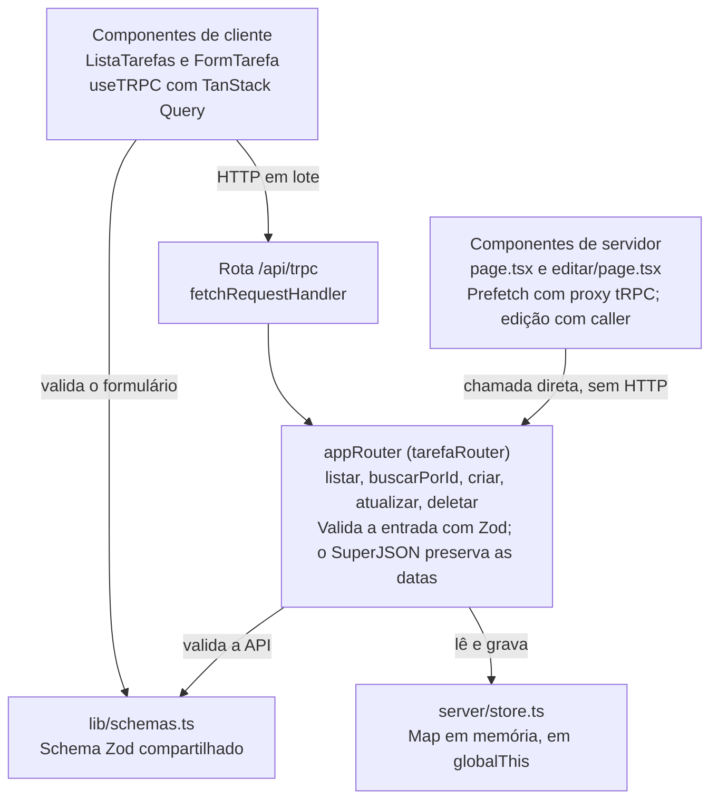

# Decisões de construção do desafio-tarefas

4 de novembro de 2026 · @Liara

## Visão geral

O projeto é um gerenciador de tarefas em Next.js com tipagem e validação compartilhadas de ponta a ponta, sem banco de dados. Ele permite listar, criar, editar e excluir tarefas com título, descrição e prioridade.

Os motivos abaixo foram deduzidos do código e dos seus comentários, pois o repositório não registra as decisões. Vale ajustar onde a intenção original tiver sido outra.

## Stack

A stack reúne front e back em um único projeto TypeScript, para que os tipos atravessem toda a aplicação.

| Tecnologia | Versão | Papel | Por que foi usada |
| --- | --- | --- | --- |
| Next.js (App Router) | 15.5 | Páginas e rota da API | Renderiza no servidor e hospeda a API no mesmo projeto |
| React | 19.1 | Interface | Base do Next.js; separa componentes de servidor e de cliente |
| TypeScript | 5 | Linguagem | Erros de contrato aparecem na compilação |
| tRPC | 11 | API | Dispensa contrato manual: o cliente importa o tipo `AppRouter` |
| TanStack Query | 5 | Dados no cliente | Cuida de cache, invalidação e paginação infinita |
| Zod | 4 | Validação | Um schema serve ao formulário e à API |
| SuperJSON | 2 | Serialização | Mantém `dataCriacao` como `Date` entre servidor e cliente |
| Tailwind CSS | 4 | Estilos | Classes utilitárias ligadas a uma paleta própria |
| Lucide | 1.68 | Ícones | Ícones importados individualmente como componentes |

## Arquitetura

Toda a lógica de tarefas fica em um único router tRPC, usado tanto pelo navegador quanto pelas páginas no servidor.

O cliente chama a API por HTTP. As páginas de servidor chamam o router diretamente, sem uma ida e volta de rede.

O código se divide em três pastas: `app/` guarda páginas e componentes, `server/` guarda API e dados, e `lib/` guarda o que os dois lados compartilham.

## Dados e estado

As tarefas ficam em memória, em um `Map` no servidor, o que mantém o projeto sem infraestrutura externa.

- **Armazenamento:** o `Map` fica em `globalThis`, para o hot reload não zerar a lista em desenvolvimento (`server/store.ts`).
- **Dados iniciais:** 30 tarefas fictícias são criadas na inicialização, o suficiente para demonstrar a rolagem infinita.
- **Paginação:** usa cursor com o timestamp da última tarefa, em páginas de 10. A API busca um item a mais para saber se há próxima página.
- **Carga inicial:** a primeira página é buscada no servidor e hidratada no cliente, que a reaproveita pela mesma chave de cache. O `staleTime` de 30 s evita uma nova busca logo após a hidratação.
- **Atualização:** cada mutação invalida as consultas de tarefas, em vez de alterar o cache manualmente. É mais simples, ao custo de uma nova busca.

## Interface e validação

A validação usa um único schema Zod (`lib/schemas.ts`) no formulário e na API, para as regras não divergirem.

- **Regras:** título obrigatório de até 100 caracteres, descrição opcional de até 500 e prioridade `media` por padrão.
- **Formulário único:** `FormTarefa` atende criação e edição. A presença da prop `tarefa` define o modo.
- **Prioridade:** `TermometroPrioridade` mostra três níveis e só fica clicável quando recebe `aoAlterar`. Assim, o mesmo componente serve à lista e ao formulário.
- **Rolagem infinita:** um `IntersectionObserver` observa um elemento no fim da lista e carrega a próxima página 200 px antes de ele aparecer.
- **Exclusão:** pede confirmação em um modal, que fecha com Esc ou com clique fora, pois a ação não pode ser desfeita.
- **Feedback:** mensagens de sucesso e erro somem após 4 s. Depois de salvar, o redirecionamento leva a mensagem no parâmetro `?ok=` da URL.
- **Cores:** a paleta é definida em variáveis CSS, com tema escuro. Tons mais escuros de texto (`--c1-ink`, `--c2-ink`) melhoram o contraste sobre fundo claro.

## Limitações conhecidas

A maior limitação é a persistência: as tarefas se perdem ao reiniciar o servidor, e cada instância teria sua própria lista. Trocar `server/store.ts` por um banco é o próximo passo natural.

- **Acesso:** todas as rotas usam `publicProcedure`, sem autenticação.
- **Paginação:** duas tarefas criadas no mesmo milissegundo podem pular a virada de página, pois o cursor compara apenas o timestamp.
- **Mensagem na URL:** `?ok=` reaparece ao recarregar a página e exibe qualquer texto colocado no parâmetro.
- **Erros de validação:** a API expõe `zodIssues`, mas o formulário não os usa e mostra só a mensagem geral.
- **URL do servidor:** `getUrl` fixa `http://localhost:3000` para chamadas fora do navegador.
- **Projeto:** não há testes automatizados, e o README ainda é o padrão do Create Next App.
